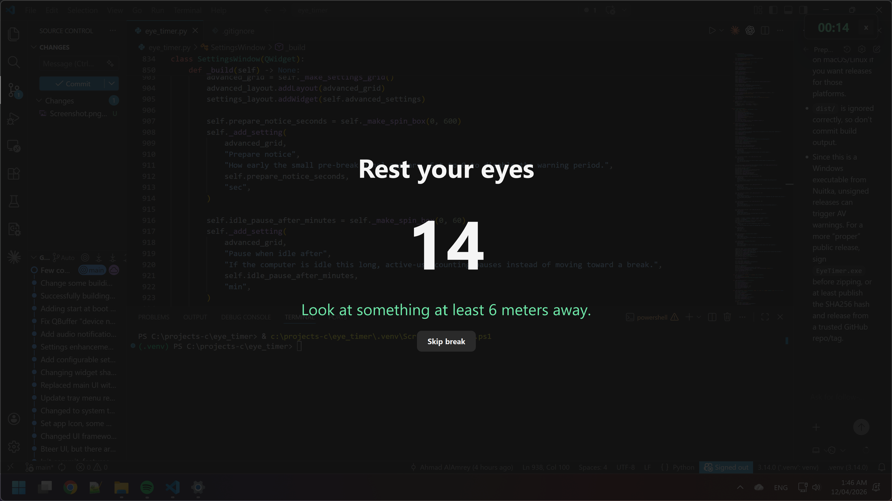

# Eye Timer

A small eye-rest reminder for Windows, macOS, and Linux.

## Features



- System tray/menu bar/status-area timer.
- Floating always-on-top countdown.
- Full-screen rest overlay with skip support.
- Pre-break notification panel.
- Configurable work interval, rest duration, idle behavior, opacity, notification
  tones, and healthy suggestion messages.

## Disclaimer

This project was built by AI, but tested on Windows 11.

## Install

```bash
pip install -e .
```

## Run

```bash
python eye_timer.py
```

The app starts in the system tray/menu bar/status area by default. Use the tray
icon menu to show the floating countdown, open settings, start a break
immediately, reset the timer, or quit.

## Settings

Use `Settings...` from the tray/status icon menu or right-click the floating
countdown. Settings are saved to `settings.json` in the platform user-data
directory for packaged builds, or next to `eye_timer.py` when running from
source, and are applied to the running timer immediately.

The settings window shows work interval and rest duration first. Less common
options are under `Show advanced settings`.

The settings window can adjust:

- Work interval before a rest break.
- Rest overlay duration.
- Pre-break notice timing.
- Idle pause and idle-as-rest timing.
- Rest overlay and pre-break panel opacity.
- Whether the countdown starts hidden.
- Notification tones for rest start and completion.
- Healthy suggestion messages.

## Notes

- The overlay is skippable with the `Skip break` button, `Esc`, or `Space`.
- The pre-break notification can be hidden for the current countdown window.
- Hovering over the tray/status icon shows the remaining time. The right-click
  tray menu also shows the remaining time at the top.
- The floating countdown is always on top, draggable, and toggleable from the
  tray/status icon menu.
- The app always uses the tray/status-area integration when the OS provides it.
  If the OS or desktop session has no tray/status area, the countdown window is
  shown instead.
- On macOS, Qt exposes the tray icon as a menu-bar status item. A packaged app
  may also need `LSUIElement=true` in its `Info.plist` to hide the Dock icon.
- On Windows, `icon.ico` is used for native taskbar/window icons and `icon.png`
  is kept as the source image.
- The notification tone MP3 files must be kept next to `eye_timer.py` when
  running from source, or bundled next to the executable when packaged.
- Multiple monitors are handled with Qt's screen APIs.
- Qt handles the main UI layout and high-DPI behavior, so the app no longer uses
  Tk-specific scaling and size-lock workarounds.
- Idle detection uses OS APIs where possible. On Linux it uses `xprintidle` if
  available, otherwise it tries XScreenSaver through `libXss`; Wayland sessions
  may fall back to counting the user as active because many compositors restrict
  global idle access.
