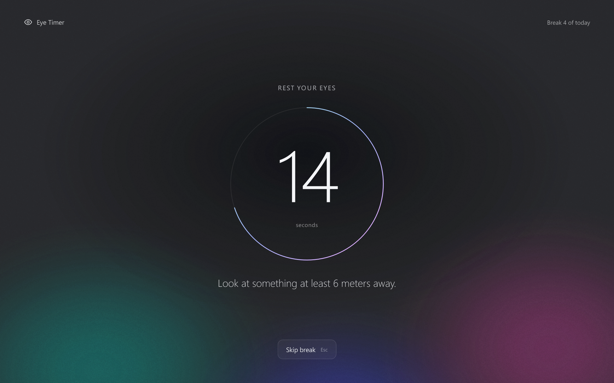
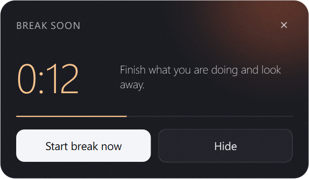
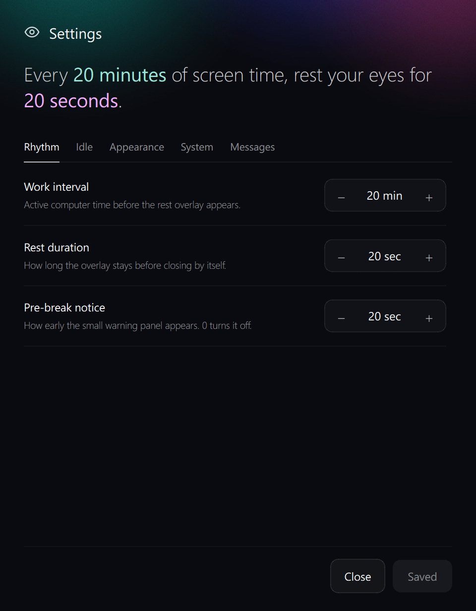

# Eye Timer

A small eye-rest reminder for Windows, macOS, and Linux, written in C++ with Qt 6.



## Features

- System tray / menu bar / status-area icon with a live progress ring.
- Floating always-on-top countdown that you can drag anywhere. Hover it to take
  a break now or hide it; it turns amber in the final minute.
- Full-screen rest overlay on every screen, with a ring countdown and a healthy
  suggestion. Skip with the `Skip break` button, `Esc`, or `Space`.
- Pre-break notice in the corner of the screen, shown without taking focus,
  with `Start break now` and `Hide`.
- Idle detection: counting pauses while you are away, and a long absence counts
  as a full rest. Sleep and resume are handled the same way.
- Notification tones when a rest starts and when it completes.
- Optional start at login.
- Settings for the work interval, rest duration, pre-break notice, idle
  behaviour, opacities, colour palette, tones, and suggestion messages.

| Countdown | Pre-break notice | Settings |
| --- | --- | --- |
|  |  |  |

## Disclaimer

This project was built by AI. It has been tested on Windows 11; the macOS and
Linux code paths compile against the same Qt APIs but have not been verified on
those systems yet.

## Build

Requirements:

- CMake 3.21+ and a C++20 compiler (MSVC 2022, GCC 11+, Clang 14+)
- Qt 6.5+ with the Widgets module
- Optional: Qt Multimedia (tone playback through Qt) and, on Linux, Qt D-Bus
  (idle time from GNOME/KDE). Without them the app falls back to other methods,
  described under Notes.

```bash
cmake -S . -B build -DCMAKE_BUILD_TYPE=Release
cmake --build build
```

If CMake cannot find Qt, point it at your Qt install with
`-DCMAKE_PREFIX_PATH=/path/to/Qt/6.x/<compiler>`.

### Windows (MSYS2)

```bash
pacman -S mingw-w64-x86_64-cmake mingw-w64-x86_64-ninja mingw-w64-x86_64-qt6-base mingw-w64-x86_64-qt6-multimedia
cmake -S . -B build -G Ninja -DCMAKE_BUILD_TYPE=Release
cmake --build build
```

To make a folder you can copy to another machine, run this from the MSYS2
MINGW64 shell:

```bash
packaging/windows/deploy-msys2.sh build dist/EyeTimer
```

It installs the app, runs `windeployqt6`, and copies the MinGW runtime DLLs
that `windeployqt6` leaves out. Distribute the whole `dist/EyeTimer` folder.
With an MSVC build of Qt, `cmake --install` followed by `windeployqt` is
enough.

### macOS

```bash
brew install cmake qt
cmake -S . -B build -DCMAKE_BUILD_TYPE=Release
cmake --build build
macdeployqt "build/Eye Timer.app"
```

The bundle sets `LSUIElement`, so the app lives in the menu bar without a Dock
icon.

### Linux

```bash
# Debian/Ubuntu
sudo apt install cmake g++ qt6-base-dev qt6-multimedia-dev
cmake -S . -B build -DCMAKE_BUILD_TYPE=Release
cmake --build build
sudo cmake --install build
```

Installing adds `EyeTimer` to the path, a desktop entry, and an icon.

## Run

Start `EyeTimer` (`Eye Timer.app` on macOS). The app starts in the system
tray / menu bar / status area. Click the icon to show or hide the floating
countdown; right-click it (or the countdown) for the menu.

`EyeTimer --render-previews <dir>` renders every window to PNG files and exits,
which is handy when working on the UI.

## Settings

Open `Settings…` from the tray menu or the countdown's right-click menu.
Changes apply to the running timer when you press `Save changes`.

Settings are stored in `settings.json` in the per-user data folder:

- Windows: `%LOCALAPPDATA%\EyeTimer`
- macOS: `~/Library/Application Support/EyeTimer`
- Linux: `$XDG_DATA_HOME/EyeTimer` (usually `~/.local/share/EyeTimer`)

Files written by the earlier Python version are read as-is.

## Fonts

The UI is designed around [Geist](https://vercel.com/font). If it is not
installed, the app falls back to Inter, Segoe UI, SF Pro or Noto Sans. To use
Geist without installing it, put its `.ttf` files in a `fonts` folder next to
the executable (or in `assets/fonts` for development builds).

## Notes

- **Tones:** played through Qt Multimedia when it is available, with a short
  silent lead-in so slow-waking audio devices don't clip the start. Otherwise
  Windows uses MCI, macOS uses `afplay`, and Linux tries `mpg123`, `ffplay`,
  `gst-play-1.0`, then `paplay`.
- **Idle detection:** Windows uses `GetLastInputInfo`, macOS uses IOKit's
  `HIDIdleTime`. Linux tries GNOME Mutter or the freedesktop ScreenSaver
  interface over D-Bus, then `xprintidle`, then the XScreenSaver extension.
  Wayland sessions without any of these count the user as always active.
- **Start at login:** a shortcut in the Startup folder on Windows, a
  LaunchAgent on macOS, an XDG autostart entry on Linux.
- **Linux windows:** the app runs through XWayland (`QT_QPA_PLATFORM=xcb`)
  unless you set `QT_QPA_PLATFORM` yourself, because native Wayland does not
  allow always-on-top windows or placing panels in a corner. If `wmctrl`,
  `xdotool`, or GNOME Shell's D-Bus interface is available it is used to keep
  the countdown on top.
- If the desktop session has no tray or status area, the countdown window is
  shown instead and closing it quits the app.
- Only one copy runs at a time.
