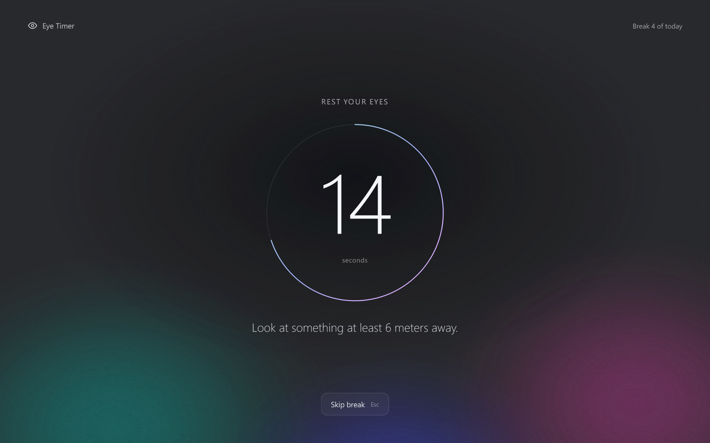
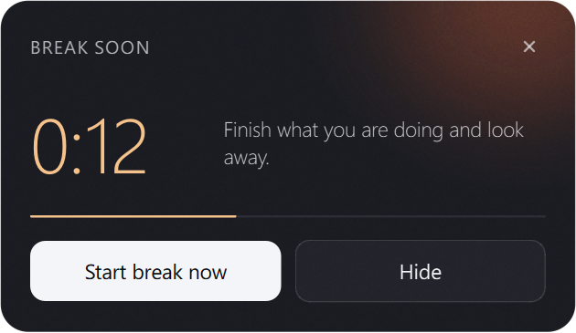
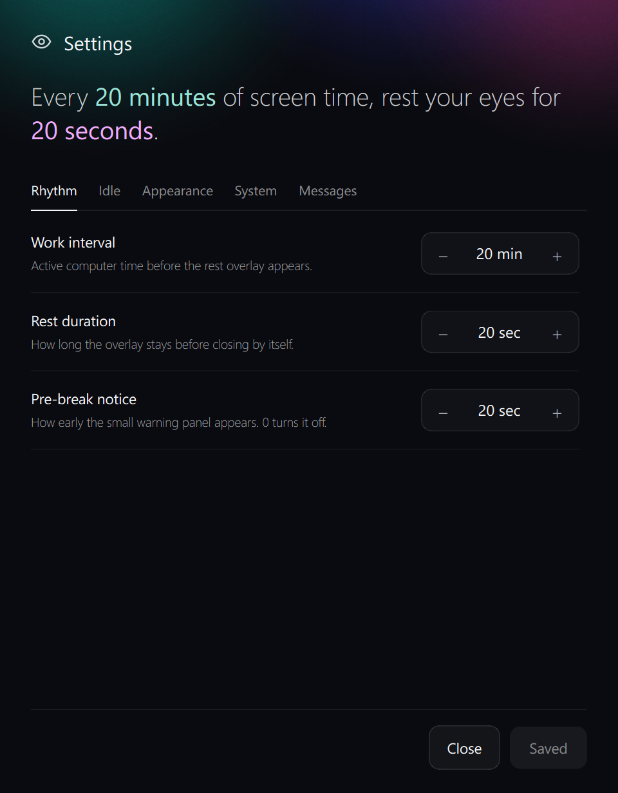

# Eye Timer

A small eye-rest reminder for Windows, macOS, and Linux, written in C++ with Qt 6.



## Download

Get the latest version from the
[releases page](https://github.com/ahmad-amrey/eye_timer/releases/latest):

| Platform | Download | Install |
| --- | --- | --- |
| Windows 10/11 (x64) | [EyeTimer-windows-x64-setup.exe](https://github.com/ahmad-amrey/eye_timer/releases/latest/download/EyeTimer-windows-x64-setup.exe) | Run it. Installs for your user only, no admin rights needed. |
| macOS 12+ (Apple silicon and Intel) | [EyeTimer-macos.dmg](https://github.com/ahmad-amrey/eye_timer/releases/latest/download/EyeTimer-macos.dmg) | Open it and drag **Eye Timer** to Applications, or anywhere you like. |
| Ubuntu 24.04+ / Debian 13+ (x64) | [EyeTimer-linux-amd64.deb](https://github.com/ahmad-amrey/eye_timer/releases/latest/download/EyeTimer-linux-amd64.deb) | Double-click it, or `sudo apt install ./EyeTimer-linux-amd64.deb`. |

To update, install the newer version the same way. Installing, updating and
uninstalling never touch your settings. Eye Timer checks for new versions once
a day and tells you when one is out. You can turn that off in Settings →
System, or check any time with **Check for updates…** in the menu.

The builds are not code-signed yet, so the first launch shows a warning:

- **Windows:** SmartScreen says "Windows protected your PC". Choose
  **More info** → **Run anyway**.
- **macOS:** Gatekeeper says the app "cannot be opened". Right-click the app,
  choose **Open**, then **Open** again. On macOS 15 and later, use
  **System Settings → Privacy & Security → Open Anyway**.
- **Linux:** installing a `.deb` asks for your password, as every Debian
  package does.

## Features

- System tray / menu bar / status-area icon with a live progress ring.
- Floating always-on-top countdown that you can drag anywhere. Hover it to take
  a break now or hide it; it turns amber in the final minute.
- Full-screen rest overlay on every screen, with a ring countdown and a healthy
  suggestion. Skip with the `Skip break` button, `Esc`, or `Space`.
- Pre-break notice in the corner of the screen, shown without taking focus,
  with `Start break now` and `Hide`.
- Idle detection: counting pauses while you are away, and a long absence counts
  as a full rest. Sleep and resume are handled the same way.
- Notification tones when a rest starts and when it completes.
- Optional start at login.
- Update notifications from GitHub releases.
- Settings for the work interval, rest duration, pre-break notice, idle
  behaviour, opacities, colour palette, tones, updates, and suggestion messages.

| Countdown | Pre-break notice | Settings |
| --- | --- | --- |
|  |  |  |

## Disclaimer

This project was built by AI. It has been tested on Windows 11 and built and
tested on Ubuntu 24.04; the macOS build is produced and smoke-tested by CI only.

## Settings and data

Open `Settings…` from the tray menu or the countdown's right-click menu.
Changes apply to the running timer when you press `Save changes`.

Settings (`settings.json`) and update-check state (`state.ini`) live in the
per-user data folder, separate from the installed program:

| Platform | Settings folder | Program |
| --- | --- | --- |
| Windows | `%LOCALAPPDATA%\EyeTimer` | `%LOCALAPPDATA%\Programs\Eye Timer` |
| macOS | `~/Library/Application Support/EyeTimer` | wherever you put `Eye Timer.app` |
| Linux | `~/.local/share/EyeTimer` (or `$XDG_DATA_HOME/EyeTimer`) | `/usr/bin/EyeTimer` |

Files written by the earlier Python version are read as they are. To remove
your settings, delete that folder after uninstalling.

## Build from source

Requirements:

- CMake 3.21+ and a C++20 compiler (GCC 11+, Clang 14+, MSVC 2022)
- Qt 6.4+ with the Widgets and Network modules (and Test for the unit tests)
- macOS and Linux: Qt Multimedia for the tones (otherwise external players
  are used, see Notes). Linux: Qt D-Bus for idle detection on GNOME/KDE.

```bash
cmake -S . -B build -DCMAKE_BUILD_TYPE=Release
cmake --build build
ctest --test-dir build
```

If CMake cannot find Qt, point it at your Qt install with
`-DCMAKE_PREFIX_PATH=/path/to/Qt/6.x/<compiler>`.

### Windows (MSYS2)

From the MSYS2 MINGW64 shell:

```bash
pacman -S mingw-w64-x86_64-gcc mingw-w64-x86_64-cmake mingw-w64-x86_64-ninja mingw-w64-x86_64-qt6-base mingw-w64-x86_64-qt6-tools
cmake -S . -B build -G Ninja -DCMAKE_BUILD_TYPE=Release
cmake --build build
packaging/windows/deploy-msys2.sh build dist/EyeTimer
```

`deploy-msys2.sh` collects the app, Qt and the MinGW runtime into
`dist/EyeTimer`. To turn that into the installer, install
[Inno Setup 6](https://jrsoftware.org/isinfo.php) and run:

```bash
iscc /DAppVersion=0.10.1 /DSourceDir=dist\EyeTimer /DOutputDir=dist packaging\windows\eye_timer.iss
```

### macOS

```bash
brew install cmake ninja qt
cmake -S . -B build -G Ninja -DCMAKE_BUILD_TYPE=Release
cmake --build build
macdeployqt "build/Eye Timer.app"
packaging/macos/make-dmg.sh "build/Eye Timer.app" dist/EyeTimer-macos.dmg
```

The bundle sets `LSUIElement`, so the app lives in the menu bar without a Dock
icon. Release builds use the Qt online installer's universal Qt, so one app
runs on Apple silicon and Intel Macs.

### Linux (Debian/Ubuntu)

```bash
sudo apt install cmake ninja-build g++ dpkg-dev qt6-base-dev qt6-multimedia-dev
cmake -S . -B build -G Ninja -DCMAKE_BUILD_TYPE=Release
cmake --build build
(cd build && cpack)          # builds eye-timer_<version>_amd64.deb
```

## Development

- `EyeTimer --render-previews <dir>` renders every window to PNG files and
  exits, which is handy when working on the UI.
- `EyeTimer --play-tone start` (or `end`) plays a notification tone and exits.
- `EYETIMER_UPDATE_URL` points the update check at another URL (`file://`
  works); `EYETIMER_NO_UPDATE_CHECK=1` turns automatic checks off.

### CI and releases

[`.github/workflows/ci.yml`](.github/workflows/ci.yml) runs on every pull
request and push to `main`. It builds on Windows, macOS and Linux, runs the
unit tests, builds the three installers, and tests them the way users get them:
install, update and uninstall, checking that settings survive.

Code is built and tested once. Every successful build is recorded under the
git tree hash of the code it built. When a later run has exactly the same
code, such as the push of a merged pull request that was up to date with
`main`, or a tag on a commit `main` already built, it skips the builds, and a
release publishes the installers from the earlier run. Anything that differs
is built and tested again. To force a fresh build, run the workflow manually
from the Actions tab with **rebuild** ticked.

Protect `main` with a ruleset (Settings → Rules → Rulesets → New branch
ruleset, target the default branch) that requires a pull request and the
**Tested** status check, with "Require branches to be up to date before
merging" on, and blocks force pushes. **Tested** is the one check to require:
it always runs and fails if any platform failed, while jobs that were skipped
would count as passing. "Up to date" is also what lets the push after a merge
reuse the pull request's build.

#### Security

What protects users from a tampered build:

- **Reuse is limited to the exact reviewed code.** A build is reused only
  from a successful run of this workflow, in this repository, whose
  checked-out commit has exactly the same tree. The workflow file is part of
  that tree, so reused installers always come from the same reviewed
  workflow. A fork's pull request, or a branch whose workflow was changed,
  can never supply them.
- **Only tags publish**, only for a commit on `main`, and only after the tag
  matches the version and changelog. The release job is the only one with
  write access. Pull requests from forks get a read-only token, and the
  workflow uses no secrets.
- **Actions are pinned to full commit SHAs**, so a moved tag in a third-party
  action can't change what runs.
- **The app opens only this repository's release pages** from its update
  notice. It never downloads or runs anything itself.

Settings to keep in GitHub:

- A **tag ruleset** (Settings → Rules → Rulesets → New tag ruleset) targeting
  `v*` that restricts creations, updates and deletions, with only you on the
  bypass list. Then only you can start a release.
- In Settings → Actions → General, set fork pull request workflows to
  "Require approval for all external contributors". Leave "Allow GitHub
  Actions to create and approve pull requests" off.
- Review changes under `.github/` in pull requests as carefully as code: the
  workflow decides what gets built and published.

To publish a release:

1. Add a `## [X.Y.Z] - YYYY-MM-DD` section to [CHANGELOG.md](CHANGELOG.md).
2. Set `project(EyeTimer VERSION X.Y.Z)` in `CMakeLists.txt`.
3. Merge to `main`, then tag that commit and push the tag:

   ```bash
   git tag vX.Y.Z
   git push origin vX.Y.Z
   ```

CI checks that the tag matches the version and the changelog, then publishes a
GitHub release with the installers, `SHA256SUMS.txt`, and the changelog
section as release notes. Running copies of Eye Timer pick it up at their next
daily update check.

## Fonts

The UI is designed around [Geist](https://vercel.com/font). If it is not
installed, the app falls back to Inter, Segoe UI, SF Pro or Noto Sans. To use
Geist without installing it, put its `.ttf` files in a `fonts` folder next to
the executable (or in `assets/fonts` for development builds).

## Notes

- **Tones:** played after a short silent lead-in so slow-waking audio devices
  don't clip the start. On Windows the MP3 is decoded with Media Foundation and
  played from memory with `PlaySound`. On macOS and Linux Qt Multimedia plays
  them on a dedicated thread; without it macOS uses `afplay`, and Linux tries
  `mpg123`, `pw-play`, `ffplay`, `gst-play-1.0`, then `paplay`.
- **Idle detection:** Windows uses `GetLastInputInfo`, macOS uses IOKit's
  `HIDIdleTime`. Linux tries GNOME Mutter or the freedesktop ScreenSaver
  interface over D-Bus, then `xprintidle`, then the XScreenSaver extension.
  Wayland sessions without any of these count the user as always active.
- **Start at login:** a shortcut in the Startup folder on Windows, a
  LaunchAgent on macOS, an XDG autostart entry on Linux.
- **Linux windows:** the app runs through XWayland (`QT_QPA_PLATFORM=xcb`)
  unless you set `QT_QPA_PLATFORM` yourself, because native Wayland does not
  allow always-on-top windows or placing panels in a corner. If `wmctrl`,
  `xdotool`, or GNOME Shell's D-Bus interface is available it is used to keep
  the countdown on top.
- If the desktop session has no tray or status area, the countdown window is
  shown instead and closing it quits the app.
- Only one copy runs at a time.
